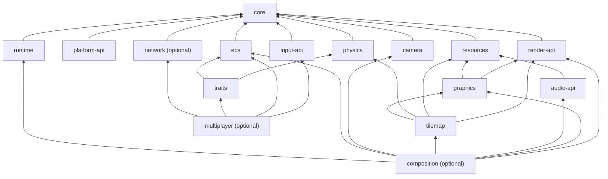

# Conceptual module breakdown

**Status: VALIDATED — module list, responsibilities and allowed dependencies (ADR-0002 to ADR-0043). Each module becomes one artifact `lionengine-<module>` (ADR-0012); its declaration and package tree are done at the build skeleton (ADR-0042).**

| Domain | Responsibility | Allowed dependencies |
|---|---|---|
| `core` | Common types, lifecycle, errors, events and listener rules, thread hand-off contracts (inbox and inbox events, asynchronous handles and load groups, worker pool, loop control and driver), logging facade, seeded random generator, strict JSON reader, definition exception, registry and typed configuration (ADR-0020, ADR-0028, ADR-0031, ADR-0032, ADR-0040) | JDK only; no frontend dependency |
| `runtime` | Game loop (implements the `core` loop driver and owns its inbox), clock, scene lifecycle contract, scene manager and scene flow (ADR-0017, ADR-0018, ADR-0021, ADR-0031, ADR-0036, ADR-0040) | `core` |
| `platform-api` | Window and surface contracts, platform object and capability lookup, lifecycle events, running the loop through the `core` loop driver, worker pool provision, screen modes and display-mode selection (ADR-0002, ADR-0020, ADR-0031, ADR-0040) | `core` |
| `render-api` | Rendering contracts: texture handles, command buffer, viewport, color-transform capability, scaling policy type, output filtering and custom filter contract (ADR-0002, ADR-0006, ADR-0026, ADR-0033) | `core` |
| `platform-awt` | Desktop implementation of `platform-api` with the JDK AWT: window and surface lifecycle, screen modes, display modes, effective-result report, `AwtSurface` capability; no rendering, input, audio or resources (ADR-0008, ADR-0033) | `platform-api`, `core`; JDK `java.desktop` only; excluded from Android builds |
| `render-awt` | AWT renderer; CPU filters `NONE`, bilinear, `Scale2x`; reaches the surface through `AwtSurface` (ADR-0022, ADR-0033) | `render-api`, `platform-api`, `platform-awt` |
| `render-opengl` | OpenGL and OpenGL ES renderer; GPU filters and shaders loaded through `resources` (ADR-0025) | `render-api`, `platform-api`, `resources` |
| `platform-android` | Android lifecycle, surface, Android asset provider adaptation, platform events | `platform-api` and the `*-api` modules it implements |
| `resources` | Keys, provider list, opening, metadata and lifecycle of resources; media-agnostic, no decoded cache; resource exception (ADR-0005, ADR-0007, ADR-0032) | `core` |
| `resources-*` | Providers: `resources-file` (filesystem), `resources-archive` (ZIP), `resources-memory` (memory and temporary storage), `resources-android` (Android assets); the application-stream provider is in `resources` (ADR-0037) | `resources` |
| `audio-api` | Backend-independent audio contracts: short and long sounds, variant sets, playlists, voices, mixer groups, fades (ADR-0004, ADR-0027, ADR-0033) | `core`, `resources` |
| `audio-*` | Audio backends per output library or platform (`audio-javasound`, `audio-android`, later `audio-openal`) and decoder modules per third-party codec (`audio-codec-ogg`); they own the decoded caches (ADR-0022, ADR-0033) | `audio-api`, `resources` |
| `graphics` | Pixel buffer, PNG decoder, image cache, sprites, sprite sheets, animations, color transforms (ADR-0003, ADR-0026, ADR-0033) | `core`, `resources`, `render-api` |
| `graphics-*` | Optional image decoders (`graphics-imageio` on desktop, `graphics-android`) registered explicitly (ADR-0026, ADR-0033) | `graphics` |
| `tilemap` | Tile maps: grid, tileset reference, loader contract and Tiled JSON loader, viewport rendering, auto-tiling, tile collision through the `physics` shape-query contract (ADR-0009, ADR-0028) | `core`, `resources`, `graphics`, `render-api`, `physics` |
| `camera` | Camera: view rectangle, view transform, zoom, translation, follow through a `long`-keyed lookup, smoothing, bounds, dead zone, shake (ADR-0010, ADR-0029, ADR-0034) | `core` |
| `input-api` | Devices, input codes, actions and bindings, per-step edges, players (ADR-0035) | `core` |
| `input-*` | Input adapters: `input-awt` (keyboard, mouse), `input-android` (touch, keys, gamepads) (ADR-0033, ADR-0035) | `input-api`, `platform-api`; `input-awt` also `platform-awt` |
| `ecs` | The object model: `World`, object IDs, trait registry and storage, cached queries, command buffer and flush, events, system ordering (ADR-0011, ADR-0021, ADR-0030, ADR-0034) | `core` |
| `physics` | Headless collision contracts: shapes (axis-aligned box first), overlap tests, shape-query contract, uniform-grid broad phase; no rigid bodies (ADR-0021, ADR-0028) | `core` |
| `traits` | Standard traits and systems: `Transformable`, `Movable`, `Gravity`, `Jumpable`, `Collidable`, `Lifetime` (ADR-0011, ADR-0030, ADR-0034) | `ecs`, `physics`, `core` |
| `composition` | Optional ready-made scene composition: world, views (`View` = camera + viewport), tile map, background, music; camera follow adapter over the world; nothing depends on it (ADR-0031) | `runtime`, `ecs`, `camera`, `graphics`, `tilemap`, `audio-api`, `render-api` |
| `network` | Optional, Phase 5: UDP, loopback and simulated-conditions transports, packet protocol, reliable-ordered and unreliable channels, server and client sessions (join by IP and name, player list and properties, kick), chat, game messages, statistics, LAN discovery; no objects; polled on the runtime thread, no thread; nothing but `multiplayer` depends on it (ADR-0038, ADR-0039) | `core` |
| `multiplayer` | Optional, Phase 5: server-authoritative replication of an ECS world: schema and content hash, delta-compressed snapshots, proxies and interpolation, input frames and commands, tick alignment, prediction with replay, standard trait codecs, host helper; nothing depends on it (ADR-0022, ADR-0038) | `network`, `ecs`, `traits`, `input-api`, `core` |
| `test-support` | Controllable clock, manually driven loop, headless frontend, fake backends, reusable contract-test suites (REQ-TEST-001) | Contracts of the modules it tests; used in `test` scope only |
| `examples` | Minimal and demonstration applications, headless first, compiled and run by the build (REQ-DOC-001) | Public APIs only; never depended upon |

## Root packages

Each module has one root package under `com.b3dgs.lionengine` (`core` is the root itself; an implementation module is a child of its API, for example `platform-awt` → `com.b3dgs.lionengine.platform.awt`). The full table is in [ADR-0037](../decisions/0037-package-tree-per-module-callbacks-and-canonical-names.md); `network` uses `com.b3dgs.lionengine.network` ([ADR-0038](../decisions/0038-network-model-server-authority-snapshots-prediction.md)). `radial-encapsulation-maven-plugin` runs per module with `basePackage` set to that root; dependencies between modules are governed by the table above and enforced by the Maven dependency graph.

## Dependency direction

Implementation modules point to the API they implement: `platform-awt` and `platform-android` → `platform-api`; `render-awt` and `render-opengl` → `render-api` (and `render-awt` → `platform-awt`); `audio-*` → `audio-api`; `resources-*` → `resources`; `input-*` → `input-api`; `graphics-*` → `graphics`. `network` → `core`; `multiplayer` → `network`, `ecs`, `traits`, `input-api`. `examples` may use every public API; `test-support` is test scope only.

The diagram shows the direct dependencies between the domain modules of the table, except edges to `core` that another arrow already implies. Producers on other threads (platform, input, audio, loaders, workers) reach the runtime thread through the `core` inbox and loop contracts, never through `runtime` (ADR-0040).

Arrows always point from the dependent module to its dependency. A cycle, or an arrow from `core` or an `*-api` module to an implementation module, is a violation (REQ-CORE-005). No module depends on `composition`, `multiplayer` or `examples`, and only `multiplayer` depends on `network`.

## Splitting principles

- A module must have a coherent responsibility and a limited public API.
- Do not automatically create one module per class or per tiny feature.
- Separate API and implementation when several plausible implementations exist or when there is a real platform boundary.
- Do not artificially split a concept if it adds complexity without isolation or testing benefit.
- Adding, renaming, splitting or merging a module follows flow B of [`../change-process.md`](../change-process.md) and needs an ADR.

## Open points

None. The build-skeleton batch declares these modules with their root packages, profiles and commands ([`../features/build-skeleton.md`](../features/build-skeleton.md), ADR-0042) and runs the Android verification job (ADR-0044).
