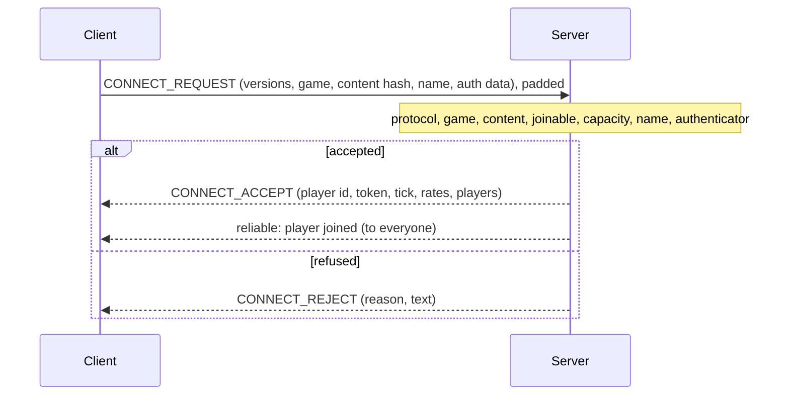

# Feature: network sessions, players, chat and messages

**Status: VALIDATED**

- Owner: project owner
- Roadmap phase: Phase 5, see `roadmap.md` (needs only `core` and `test-support`, so it may start earlier if a game needs it)
- Flow: B of [`change-process.md`](../change-process.md) (new module `network`); ADRs written and accepted
- Affected modules: `network`, `test-support`, `examples`; `platform-android` (multicast lock capability, last batch)
- Requirements: `REQ-NET-001` to `REQ-NET-017`
- Applicable ADRs: [`ADR-0018`](../decisions/0018-runtime-thread-events-and-cache-thread-safety.md), [`ADR-0020`](../decisions/0020-no-reflection-factory-registry-and-capability-lookup.md), [`ADR-0031`](../decisions/0031-runtime-defaults-loop-calibration-inbox-scenes-platform-lifecycle.md), [`ADR-0032`](../decisions/0032-definition-files-registry-ids-resource-providers-dependency-policy.md), [`ADR-0037`](../decisions/0037-package-tree-per-module-callbacks-and-canonical-names.md), [`ADR-0038`](../decisions/0038-network-model-server-authority-snapshots-prediction.md), [`ADR-0039`](../decisions/0039-network-protocol-transport-sessions-and-defaults.md)
- Open questions involved: none (Android verification of the socket APIs by the Android job, ADR-0041)

## Objective

Let a game host a session (the host also plays) or run a dedicated server, let players join by IP address and port with a name, list the players, chat, and exchange game-defined messages, over UDP, with a protocol that can later be secured without changing the game's code. Object replication is the separate `multiplayer` module ([`multiplayer.md`](multiplayer.md)); a game without objects (cards, turn-based) can use `network` alone.

## Out of scope

Replication of ECS objects, prediction and interpolation (`multiplayer`); NAT traversal, relays, matchmaking, internet server lists; host migration; reconnection to the same slot; encryption and authentication protocols (extension points only); voice; host names (IP literals only, a later batch through the worker pool); several players on one online client.

## Expected behavior

### Roles and driving (`REQ-NET-001`, `REQ-NET-017`)

- `NetworkServer` listens on a port; `NetworkClient` joins a server. A host creates a server and a client connected to it through the loopback transport (`multiplayer` provides `Host`; with `network` alone the game connects its client to `LoopbackNetwork` itself).
- Everything runs on the runtime thread. Once per loop step the game calls `update()` on its session (or `multiplayer` does it for it): it polls the transport, processes received packets, calls listeners, then sends what is due. No thread is started; nothing blocks.
- Time comes from a `NetworkTime` given at construction (default `System.nanoTime`); tests use a controllable time. All durations of the API are seconds (`double`).

### Transport (`REQ-NET-002`)

| Item | Value |
|---|---|
| Protocol | UDP, one non-blocking `DatagramChannel` per session, API 21 calls only (`open()`, `socket().bind`, `configureBlocking(false)`, `receive`, `send`) |
| Addresses | IPv4 and IPv6 literals plus a port; no DNS lookup |
| Default port | 19880, configurable in `[1024, 65535]`; clients bind an ephemeral port |
| Datagram payload | at most 1,200 bytes by default, configurable in `[512, 1472]` |
| Loopback | `LoopbackNetwork` links in-process transports, no socket; delivers at the next poll |
| Conditions | `ConditionedTransport` wraps any transport with `NetworkConditions`: latency (s), jitter (s), loss, duplication and reordering ratios in `[0, 1]`, seed; deterministic for a seed and a time sequence |

### Packets (`REQ-NET-003`, `REQ-NET-015`)

- Header of 21 bytes, big-endian: CRC32 checksum (over protocol id `0x4C494F4E`, protocol version `1` and the rest of the packet; id and version not sent), type (1 byte), session token (8), sequence (`uint16`), ack (`uint16`), ack bits (32 bits).
- Types: `INFO_REQUEST`, `INFO_RESPONSE`, `CONNECT_REQUEST`, `CONNECT_ACCEPT`, `CONNECT_REJECT`, `DATA`, `DISCONNECT`.
- Sequence comparison with wrap-around: `a` is newer than `b` when `(a - b) & 0xFFFF` is in `[1, 32767]`.
- A packet with a wrong checksum, an unknown type, a read past its end, a value out of range, or a token or address not matching a connection is dropped and counted; nothing is thrown into game code.
- `NetWriter` and `NetReader` over preallocated arrays: byte, boolean, `int`, `long`, varint (LEB128; zigzag for signed), `float` and `double` as exact IEEE bits, UTF-8 string with a varint length and a maximum checked on read.

### Channels (`REQ-NET-004`)

- Unreliable-sequenced entries: an entry older than the last delivered one of its stream is dropped.
- Reliable-ordered messages: `uint16` message id; repeated in later packets until acknowledged, at most once every 0.1 s; at most 256 in flight; send queue at most 1,024 messages, beyond which the connection closes with `OVERFLOW`; delivered once, in order, to their listener.
- Fragmentation of messages up to 64 KiB (and of `multiplayer` snapshots) into datagram-sized fragments.
- Keepalive: an empty `DATA` packet when nothing was sent for 0.1 s.

### Joining (`REQ-NET-005`, `REQ-NET-014`)

- `ClientConfig`: server address and port, player name, game id (`namespace:name`), game version (`int`), extra content hash (`int`, default 0; `multiplayer` passes its schema hash), authentication data (bytes, default empty, at most 512).
- Content hash: 32-bit FNV-1a over the registered message types (ids, deliveries, order) and the extra content hash; computed the same way on the server from `ServerConfig`.
- `CONNECT_REQUEST` padded to the maximum datagram size, resent every 0.5 s; the attempt fails with `TIMEOUT` after 10 s.
- Server checks in this order, the first failure being the `RejectReason`: `PROTOCOL_MISMATCH`, `GAME_MISMATCH`, `CONTENT_MISMATCH`, `NOT_JOINABLE`, `SERVER_FULL`, `NAME_INVALID`, `NAME_TAKEN`, `AUTH_FAILED` (`Authenticator` callback, default accept, optional text).
- `CONNECT_ACCEPT`: player id, session token (64 bits from `SecureRandom`), server tick, step rate (Hz), snapshot interval (ticks), server name, player list. A repeated request gets the same answer.
- One pending connection per source address. The `PacketProtection` stage is the identity in protocol version 1.

### Liveness and leaving (`REQ-NET-006`)

- Timeout 10 s without any packet (configurable in `[1, 60]` s).
- `DISCONNECT` sent three times with a `DisconnectReason`: `QUIT`, `KICKED` (with text), `SERVER_SHUTDOWN`, `TIMEOUT`, `OVERFLOW`, `PROTOCOL_ERROR`.
- `ConnectionState` of a client: `DISCONNECTED` → `CONNECTING` → `CONNECTED` → `DISCONNECTED`; a `ConnectionListener` receives each change with its reject or disconnect reason.

### Players (`REQ-NET-007`, `REQ-NET-008`, `REQ-NET-009`)

- `PlayerInfo`: id (`int` from 1, never reused in a session; `0` is the server), name (1 to 24 characters after trimming, no control character, unique ignoring case with `Locale.ROOT`), host flag, round trip in seconds, properties.
- Maximum players: 16 by default (host's player included), configurable in `[1, 64]`.
- Properties: at most 16 per player; key `[a-z][a-z0-9_-]*`, at most 32 characters; value at most 128 characters. Set by the server, or requested by the player and accepted by the `PropertyValidator` (default accept). Replicated reliably.
- `PlayerList`: identical on every peer, ordered by id; `PlayerListener` events: joined, left (with `DisconnectReason`), changed (name or property). Round trips are broadcast once per second.
- Server administration: kick with a text, open or close joining (`NOT_JOINABLE`), set the server name, stop (`SERVER_SHUTDOWN` to everyone). A player may request a name change, checked like a new name.

### Chat (`REQ-NET-010`)

- `ChatMessage`: sender id (`0` = server), sender name at sending time, target (everyone or one player id), text of 1 to 256 characters, server tick of delivery.
- Client → server reliably → `ChatFilter` (default unchanged; may change the text or drop) → relayed to the targets → `ChatListener` on each target.
- Rate limit per player: token bucket of 5, refilled at 1 per second; an excess message is dropped and its sender receives a server notice.

### Game messages (`REQ-NET-011`)

- `MessageType<T>`: registry id `namespace:name`, `MessageCodec<T>` (write, read), `Delivery` `RELIABLE` or `UNRELIABLE`. Registered in the same order on both sides; included in the content hash.
- Client → server; server → one player, everyone, everyone but one. `MessageListener<T>` gets `(senderId, message)` on the runtime thread during `update()`.
- Size: at most 64 KiB reliable, one datagram unreliable; larger throws `IllegalArgumentException` at sending.

### Measurements (`REQ-NET-012`)

`ConnectionStats` per connection, read without allocation: round trip (s, smoothing factor 0.1), packet loss over the last 64 sent packets, sent and received bytes per second (smoothed with the same factor), dropped packets by cause, resent reliable messages, connection attempts.

### Server information and LAN discovery (`REQ-NET-013`)

- `INFO_REQUEST` (padded) → `INFO_RESPONSE` as `ServerInfo`: server name, game id and version, protocol version, players, maximum, joinable.
- `Discovery` broadcasts to `255.255.255.255` at the game port and collects answers for 1 s by default (configurable in `[0.1, 10]` s). On Android the hosting device holds the Wi-Fi multicast lock, a capability of `platform-android`.

### Allocation (`REQ-NET-016`)

In steady state, sending and receiving unreliable traffic (frames, snapshots, keepalives, acknowledgements) allocates nothing on the engine side; what the JDK allocates for a received sender address is measured and recorded in the batch. Joining, reliable messages, chat, player events and strings may allocate.

## Envisaged APIs / contracts

Responsibilities in [`../architecture/contracts.md`](../architecture/contracts.md) (Network and multiplayer); canonical names in [ADR-0038](../decisions/0038-network-model-server-authority-snapshots-prediction.md) section 16: `NetworkServer`, `NetworkClient`, `ServerConfig`, `ClientConfig`, `Transport`, `UdpTransport`, `LoopbackNetwork`, `ConditionedTransport`, `NetworkConditions`, `NetworkTime`, `PlayerInfo`, `PlayerList`, `PlayerListener`, `ConnectionListener`, `ConnectionState`, `DisconnectReason`, `RejectReason`, `ChatMessage`, `ChatListener`, `ChatFilter`, `MessageType<T>`, `MessageCodec<T>`, `MessageListener<T>`, `Delivery`, `Authenticator`, `PropertyValidator`, `NetWriter`, `NetReader`, `ConnectionStats`, `ServerInfo`, `Discovery`, `PacketProtection`. Signatures are written by the batches under `conventions.md`.

## Batches (order)

1. `NetWriter`, `NetReader`, packet header, checksum, sequence comparison, ack bits (`REQ-NET-003`, `REQ-NET-015`).
2. `Transport`, `LoopbackNetwork`, `ConditionedTransport`, `UdpTransport`, transport contract suite in `test-support` (`REQ-NET-002`, `REQ-NET-017`).
3. Connection: join, reject reasons, tokens, keepalive, timeout, disconnect, round trip and statistics (`REQ-NET-005`, `REQ-NET-006`, `REQ-NET-012`, `REQ-NET-014`).
4. Reliable-ordered channel and fragmentation (`REQ-NET-004`, `REQ-NET-016`).
5. Players, properties, administration (`REQ-NET-007` to `REQ-NET-009`).
6. Chat and game messages (`REQ-NET-010`, `REQ-NET-011`); headless example: a host and two clients over loopback listing players and chatting.
7. Server information and LAN discovery, Android multicast lock capability (`REQ-NET-013`).

## Lifecycle and concurrency

The game creates a session, configures listeners, calls `update()` once per step on the runtime thread, and closes it (`close()` sends `DISCONNECT` or `SERVER_SHUTDOWN` and releases the socket; idempotent). A session typically lives in the scene-flow context so that a lobby scene and a level scene share it (ADR-0036). Listeners run during `update()`; registering a listener during a dispatch takes effect after it (ADR-0018). The session is not thread-safe.

## Units and Android/DEX compatibility

Seconds for every duration, bytes for sizes, ticks as `int`. JDK APIs: `java.nio.channels.DatagramChannel`, `java.net.InetSocketAddress`, `java.util.zip.CRC32`, `java.security.SecureRandom`, `java.nio.charset.StandardCharsets` (API 19). All are at API 21 without desugaring but are **not compatible yet** until checked by the Android job (ADR-0041, [`../android-compatibility.md`](../android-compatibility.md)). The game declares `android.permission.INTERNET`; network calls must not run on the Android main thread (the runtime thread is the render thread there). No `java.util.function`, `Optional` or streams (ADR-0037).

## Dependencies

`network` on `core` only. Forbidden: `ecs`, `runtime`, any platform, render or input module; a third-party networking library (none needed; any later one needs its register entry, ADR-0032).

## Tests

- Unit tests: writer and reader (every type, limits, read past the end), checksum with another protocol id or version, sequence wrap-around, ack bits, reliable ordering, resend interval, window and overflow, fragmentation and reassembly with missing fragments, each reject reason in order, name rules, property limits, timeouts and keepalive with a controllable time, chat filter and rate limit, statistics.
- Contract tests (`test-support`): one transport suite run on `LoopbackNetwork` and on `UdpTransport` bound to the local loopback address.
- Integration tests: a server and three clients over loopback with `ConditionedTransport` (latency 0.1 s, jitter 0.02 s, loss 0.1, duplication 0.05, reordering 0.05, fixed seed): every reliable message delivered once and in order, identical player lists, chat delivered, disconnect and timeout detected.
- Platform tests: two processes over UDP on a real network, kept apart from the headless suite; Android device test with the multicast lock.

## Acceptance criteria

- [ ] Requirements `REQ-NET-001` to `REQ-NET-017` verified.
- [ ] Automated tests added and passing; complete Javadoc (units, thread, limits).
- [ ] Headless example (host and two clients, players and chat) and `api-index.md` entry.
- [ ] No forbidden coupling; Android/DEX compatibility of the socket APIs verified.
