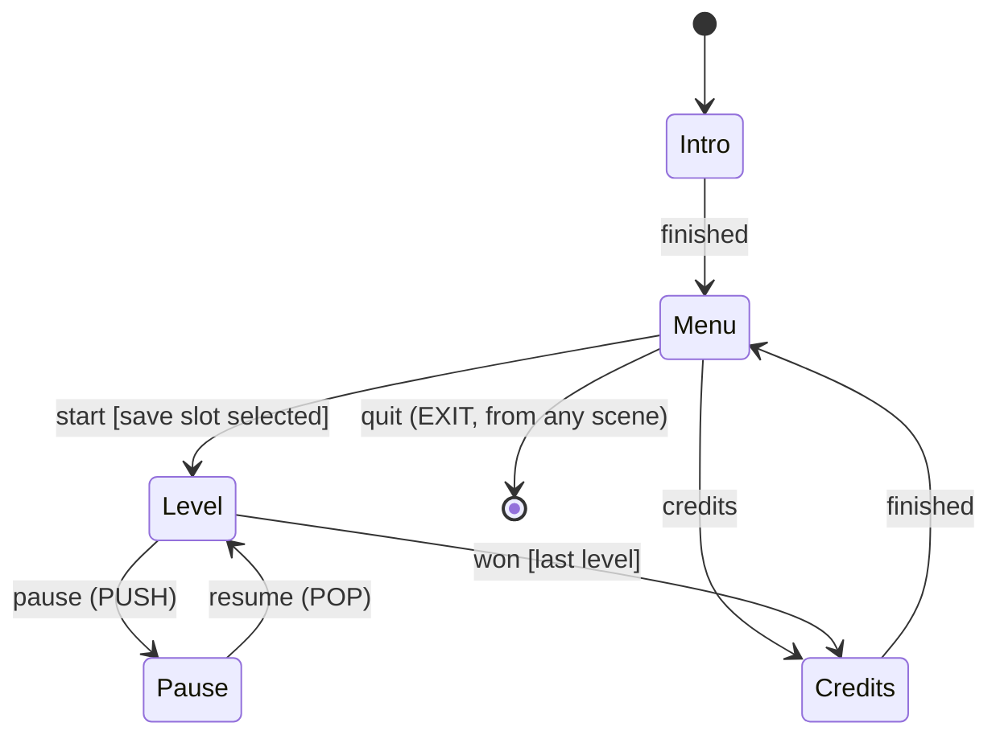

# Feature: scenes, scene manager and scene flow

**Status: VALIDATED**

- Owner: project owner
- Roadmap phase: Phase 1 (scene contract and manager), Phase 2 (overlay stack and scene flow), see `roadmap.md`
- Affected modules: `runtime`, `test-support`, `examples`
- Requirements: `REQ-SCENE-001` to `REQ-SCENE-008`
- Applicable ADRs: [`ADR-0017`](../decisions/0017-fixed-step-game-loop.md), [`ADR-0018`](../decisions/0018-runtime-thread-events-and-cache-thread-safety.md), [`ADR-0021`](../decisions/0021-scene-world-viewport-and-object-model.md), [`ADR-0031`](../decisions/0031-runtime-defaults-loop-calibration-inbox-scenes-platform-lifecycle.md), [`ADR-0032`](../decisions/0032-definition-files-registry-ids-resource-providers-dependency-policy.md), [`ADR-0036`](../decisions/0036-scene-flow-ids-triggers-conditions-transitions.md)
- Open questions involved: none

## Objective

Split a game into scenes (introduction, menu, level, pause, credits) and declare in one place how the game moves from one to another, with links triggered by name and guarded by conditions.

## Out of scope

Scene content (world, camera, music: game code or `composition`); visual transitions (drawn by the game); nested or parallel state machines, history states, automatic timers; flows read from data files (a later ADR if needed).

## Expected behavior

### Scene contract (`REQ-SCENE-001`)

- `enter()`: called once, before the first update; acquire resources, start loads.
- `update(stepSeconds)`: once per fixed step while the scene is on top.
- `render(alpha, unscaledDeltaSeconds)`: once per presentation while the scene is in the stack (bottom to top).
- `exit()`: called once when the scene leaves the stack; stop sounds, release acquired resources.
- `dispose()`: called once after `exit()`; the instance is never used again.

A scene knows nothing of world, camera, graphics or audio types; it composes them itself.

### Scene manager (`REQ-SCENE-002`, `REQ-SCENE-003`)

- First batch: one active scene; `switchTo(scene)` applies at the next frame boundary: current `exit`, `dispose`, then next `enter`.
- Second batch: overlay stack with `push(scene)` and `pop()` at the frame boundary; only the top scene updates; all render bottom to top; a covered scene keeps its state.

### Scene flow (`REQ-SCENE-004` to `REQ-SCENE-008`)

- Built with a builder, validated at `build()`, immutable afterwards:
  - scenes: id `namespace:name` → factory `context → new scene instance`;
  - start id;
  - transitions `(from id or any scene, trigger, optional condition on the context, kind, target id)`.
- Kinds: `SWITCH` (replace the whole stack), `PUSH` (overlay), `POP` (close the top overlay), `EXIT` (dispose everything, request the loop stop).
- `trigger(name)` on the runtime thread: tries the top scene's transitions, then the any-scene transitions, each in declaration order; the first with that trigger and a true condition is selected and `true` is returned; otherwise `false` and nothing happens.
- The selected transition applies at the next frame boundary; until then other triggers return `false`.
- Every entry creates a new instance from the factory; data travels between scenes through the context object.
- Build errors (`IllegalStateException`): duplicate or invalid id, unknown start or target, invalid trigger name, wrong shape for the kind.
- Observation: stack ids (top first) and a transition listener `(fromId, trigger, toId or none)`.

## Envisaged APIs / contracts

Responsibilities in [`../architecture/contracts.md`](../architecture/contracts.md) (Scenes); signatures written by the batch under `conventions.md`: `Scene`, `SceneManager`, `SceneFlow<C>` and its builder, transition kind enum, transition listener.

## Batches (order)

1. Scene contract and single-scene manager (`REQ-SCENE-001`, `REQ-SCENE-002`) — Phase 1.
2. Overlay stack (`REQ-SCENE-003`) — Phase 2.
3. Scene flow with `SWITCH` and `EXIT`, validation, listener (`REQ-SCENE-004` to `REQ-SCENE-008`) — Phase 2.
4. `PUSH` and `POP` transitions in the flow — Phase 2, after batch 2.

## Lifecycle and concurrency

Runtime thread only (ADR-0018). Transitions never apply inside a step. An exception in a factory or a lifecycle call stops the loop in the failed state (ADR-0017).

## Units and Android/DEX compatibility

Seconds; ids and trigger names are strings. Pure Java (`java.util.function` interfaces need verification at API 21 or own functional interfaces, `android-compatibility.md`).

## Dependencies

`runtime` on `core`. Forbidden: any dependency of `runtime` on `ecs`, `camera`, `graphics`, audio or platform modules.

## Tests

- Unit tests: lifecycle order, switch at a frame boundary, overlay update and render calls, transition resolution order, conditions, any-scene fallback, single pending transition, each validation error, listener calls, new instance per entry.
- Integration tests: a headless flow Intro → Menu → Level → Pause → Level → Credits → exit driven by a manually driven loop and a controllable clock.

## Acceptance criteria

- [ ] Requirements `REQ-SCENE-001` to `REQ-SCENE-008` verified.
- [ ] Automated tests added and passing; complete Javadoc.
- [ ] Headless example of a four-scene flow and `api-index.md` entry.
- [ ] No forbidden coupling; Android/DEX compatibility verified.
