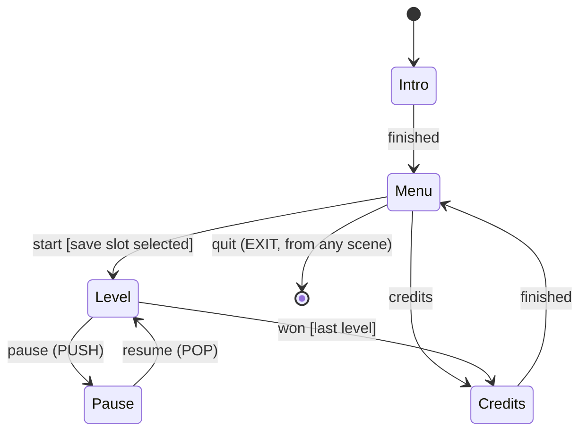

# Feature: scenes, scene manager and scene flow

**Status: VALIDATED**

- Owner: project owner
- Roadmap phase: Phase 1 (scene contract and manager), Phase 2 (overlay stack and scene flow), see `roadmap.md`
- Affected modules: `runtime`, `examples` (`runtime` tests use the controllable clock of its own test JAR, ADR-0045)
- Requirements: `REQ-SCENE-001` to `REQ-SCENE-008`
- Applicable ADRs: [`ADR-0017`](../decisions/0017-fixed-step-game-loop.md), [`ADR-0018`](../decisions/0018-runtime-thread-events-and-cache-thread-safety.md), [`ADR-0021`](../decisions/0021-scene-world-viewport-and-object-model.md), [`ADR-0031`](../decisions/0031-runtime-defaults-loop-calibration-inbox-scenes-platform-lifecycle.md), [`ADR-0032`](../decisions/0032-definition-files-registry-ids-resource-providers-dependency-policy.md), [`ADR-0036`](../decisions/0036-scene-flow-ids-triggers-conditions-transitions.md), [`ADR-0059`](../decisions/0059-overlay-stack-one-change-per-frame-switch-replaces-stack.md)
- Open questions involved: none

## Objective

Split a game into scenes (introduction, menu, level, pause, credits) and declare in one place how the game moves from one to another, with links triggered by name and guarded by conditions.

## Out of scope

Scene content (world, camera, music: game code or `composition`); visual transitions (drawn by the game); nested or parallel state machines, history states, automatic timers; flows read from data files (a later ADR if needed).

## Expected behavior

### Scene contract (`REQ-SCENE-001`)

- `enter()`: called once, before the first update; acquire resources, start loads.
- `update(stepSeconds)`: once per fixed step while the scene is on top.
- `render(alpha, unscaledDeltaSeconds)`: once per presentation while the scene is in the stack (bottom to top).
- `exit()`: called once when the scene leaves the stack; stop sounds, release acquired resources.
- `dispose()`: called once after `exit()`; the instance is never used again.

A scene knows nothing of world, camera, graphics or audio types; it composes them itself.

### Scene manager (`REQ-SCENE-002`, `REQ-SCENE-003`)

- First batch: one active scene; `switchTo(scene)` applies at the next frame boundary: current `exit`, `dispose`, then next `enter`.
- Second batch: overlay stack with `push(scene)` and `pop()` at the frame boundary; only the top scene updates; all render bottom to top; a covered scene keeps its state.

### Scene flow (`REQ-SCENE-004` to `REQ-SCENE-008`)

- Built with a builder, validated at `build()`, immutable afterwards:
  - scenes: id `namespace:name` → `SceneFactory<C>` (`create(context)` returns a new scene instance);
  - start id;
  - transitions `(from id or any scene, trigger, optional `TransitionCondition<C>` (`test(context)`), kind, target id)`.
- Kinds: `SWITCH` (replace the whole stack), `PUSH` (overlay), `POP` (close the top overlay), `EXIT` (dispose everything, request the loop stop).
- `trigger(name)` on the runtime thread: tries the top scene's transitions, then the any-scene transitions, each in declaration order; the first with that trigger and a true condition is selected and `true` is returned; otherwise `false` and nothing happens.
- The selected transition applies at the next frame boundary; until then other triggers return `false`.
- Every entry creates a new instance from the factory; data travels between scenes through the context object.
- Build errors (`IllegalStateException`): duplicate or invalid id, unknown start or target, invalid trigger name, wrong shape for the kind.
- Observation: stack ids (top first) and a transition listener `(fromId, trigger, toId or none)`.

## Envisaged APIs / contracts

Responsibilities in [`../architecture/contracts.md`](../architecture/contracts.md) (Scenes); canonical names (ADR-0037): `Scene`, `SceneManager`, `SceneFlow<C>`, `SceneFlowBuilder<C>`, `SceneFactory<C>`, `TransitionCondition<C>`, `TransitionKind`, `TransitionListener`; signatures written by the batch under `conventions.md`. `Scene` is declared by the contract skeleton (ADR-0049, [`contract-skeleton.md`](contract-skeleton.md)).

## Batches (order)

1. Scene contract and single-scene manager (`REQ-SCENE-001`, `REQ-SCENE-002`) — Phase 1.
2. Overlay stack (`REQ-SCENE-003`) — Phase 2.
3. Scene flow with `SWITCH` and `EXIT`, validation, listener (`REQ-SCENE-004` to `REQ-SCENE-008`) — Phase 2.
4. `PUSH` and `POP` transitions in the flow — Phase 2, after batch 2.

## Lifecycle and concurrency

Runtime thread only (ADR-0018). Transitions never apply inside a step. An exception in a factory or a lifecycle call stops the loop in the failed state (ADR-0017).

## Units and Android/DEX compatibility

Seconds; ids and trigger names are strings. Pure Java; callbacks are the role-named interfaces `SceneFactory<C>`, `TransitionCondition<C>` and `TransitionListener`, not `java.util.function` (ADR-0037).

## Dependencies

`runtime` on `core`. Forbidden: any dependency of `runtime` on `ecs`, `camera`, `graphics`, audio or platform modules.

## Tests

- Unit tests: lifecycle order, switch at a frame boundary, overlay update and render calls, transition resolution order, conditions, any-scene fallback, single pending transition, each validation error, listener calls, new instance per entry.
- Integration tests: a headless flow Intro → Menu → Level → Pause → Level → Credits → exit driven by a manually driven loop and a controllable clock.

## State (2026-11-26)

Batches 1 to 3 are implemented in `runtime`, with the examples `SceneExample`, `PauseOverlayExample` and `SceneFlowExample` and their API-index rows; batch 4 (`PUSH` and `POP` in the flow) is not. Batch 1 (2026-11-24): Names and details chosen by the batch, within this page, ADR-0021 and ADR-0031:
- `SceneManager` implements `UpdateCallback` and `RenderCallback`, so a simple game gives it to `GameLoop` as both callbacks; a game with input calls its `update` and `render` from its own callbacks. The frame ends with `render`, which must therefore be called once per frame, even when nothing is drawn.
- `switchTo(scene)` returns whether the request is accepted: the first request of a frame wins and later ones return `false` (their scenes receive no call), as ADR-0036 decides for triggers, so a request repeated at every step, or in every step of a catch-up frame, gives the same result. The switch applies at the first `update` or `render` call of the next frame: exit and dispose the current scene, enter the next, which is then updated and rendered in that frame. The active scene itself and `null` are rejected (`IllegalArgumentException`).
- `isSwitchPending()`, `hasActive()` and `getActive()` (`null` when none) observe the manager. `clear()` exits and disposes the active scene and cancels a pending switch at once: the game calls it once the loop has stopped or failed. A scene calling `clear()`, `update` or `render` of the manager from a method the manager called gets an `IllegalStateException`.
- Exceptions of scenes propagate unchanged, so the loop fails (ADR-0017). A scene whose `exit` threw is still disposed, and one whose `enter` threw is disposed but not exited (ADR-0052); a failing disposal is added to the first exception as a suppressed one, and when the exit of the current scene throws, the next scene is not entered; a scene whose `update` or `render` threw stays active, so `clear()` still exits and disposes it.
- The manager allocates nothing in steady state, switches included (allocation test). Test fixture (ADR-0045): `RecordingScene` in the `runtime` test JAR, which records the lifecycle calls of several scenes in one list.

Batch 2 (2026-11-26), the overlay stack. The details this page and ADR-0031 leave open follow ADR-0059 (owner delegation):
- `push(scene)` enters a scene on top of the stack at the next frame boundary; only the top scene is updated, every scene is rendered from the bottom; the covered scenes receive no other call and keep their state. On an empty stack, a push enters the scene alone. `pop()` exits and disposes the top scene at the boundary; the scene below is the top again without any call. A pop needs at least two scenes in the stack (`IllegalStateException` otherwise), so an overlay never leaves the game without a scene.
- `switchTo(scene)` now replaces the whole stack: every scene is left from the top to the bottom, then the new one is entered alone. A scene in the stack cannot be switched to or pushed again (`IllegalArgumentException`).
- One change per frame, whatever its kind: the first switch, push or pop of a frame wins, the others return `false` and their scenes receive no call (the rule of batch 1 and of ADR-0036). `isChangePending()` tells whether any change waits, `isSwitchPending()` whether a switch does; `getActive()` is the top scene, `getSceneCount()` and `getScene(index)` (from the bottom) give the stack.
- Failures (ADR-0052 extended): when several scenes leave together (a switch, `clear()`), every one is left, each failed exit still disposed; the first exception propagates once all are left, the later ones suppressed; a failed switch enters no scene and leaves the stack empty. A pushed scene whose enter throws is disposed and not added; a popped scene whose exit throws is still disposed and removed.
- No allocation in steady state: the stack (an array of initial capacity 4) grows only when it gets deeper than ever before.
- Tests: `SceneOverlayTest` (push and pop requested during an update and applied at the next boundary, update and render calls per scene, a stack of seven scenes, one change per frame, switch over overlays, push on an empty stack, invalid requests, clear, each failure, no allocation in 1,000 push and pop cycles); the tests of batch 1 unchanged; `PauseOverlayExampleTest` (a level paused for 0.25 second by a menu: the level's play time counts only its own steps, and it is rendered under the menu); device test `RuntimeTest.testOverlayStack` on API 21.

Batch 3 (2026-11-26), the scene flow with `SWITCH` and `EXIT`. Names and details chosen by the batch, within this page and ADR-0036:
- Types (canonical names of ADR-0037): `SceneFlowBuilder<C>` (`scene(id, factory)`, `start(id)`, `transition(from, trigger, kind, to)`, `transition(from, trigger, condition, kind, to)`, `listener(listener)`, `build()`, and `ANY_SCENE` (`*`) as the source of a transition from any scene), `SceneFlow<C>`, `SceneFactory<C>` (`create(context)`), `TransitionCondition<C>` (`test(context)`), `TransitionKind` (`SWITCH`, `EXIT`; `PUSH` and `POP` come with batch 4) and `TransitionListener` (`onTransition(fromId, trigger, toId)`, `toId` `null` for an exit). Role-named interfaces, not `java.util.function`.
- Building: a `null` argument is an `IllegalArgumentException` at once; every other mistake is reported by `build()` as an `IllegalStateException` naming the first problem: invalid or duplicated id, start missing, given twice or not declared, source or target not declared, invalid trigger name, target given to an `EXIT` or missing on a `SWITCH`. A builder builds independent flows.
- Running: the flow drives its own `SceneManager` and is given to the loop as both callbacks. `start(context, loop)` (once; the context may be `null`, the `LoopControl` is needed by `EXIT`) enters the start scene at the next frame boundary. `trigger(name)` resolves at once against the top scene, then any scene, in declaration order, with the conditions; it returns `false` when nothing matches, while a transition or the start is pending, and after an exit; an invalid name is an `IllegalArgumentException`, a trigger before `start` an `IllegalStateException`.
- At the boundary: the factory of the target is called then (with the context at that time), and the manager replaces its stack by the new scene; an exit leaves every scene and requests the loop stop. The listener is called once the transition is applied, before the first update of the frame (the package-private `SceneManager.beginFrame()` applies the manager's change before its update). A factory returning `null` is an `IllegalStateException`. `getSceneIds()` (top first), `isTransitionPending()`; `clear()` at the end of the game.
- Triggers, updates and renders allocate nothing (allocation test after a warm-up run).
- Tests: `SceneFlowTest` (start, switch at the frame boundary with the listener before the next update, new instance per entry with the context, resolution order and conditions, any-scene fallback, one pending transition, exit, clear, factory failures, each validation error, independent flows, no allocation); `SceneFlowExampleTest` (introduction, menu, level, credits, exit from any scene, a condition on the context); device test `RuntimeTest.testSceneFlow` on API 21.

## Acceptance criteria

- [ ] Requirements `REQ-SCENE-001` to `REQ-SCENE-008` verified.
- [ ] Automated tests added and passing; complete Javadoc.
- [ ] Headless example of a four-scene flow and `api-index.md` entry.
- [ ] No forbidden coupling; Android/DEX compatibility verified.
