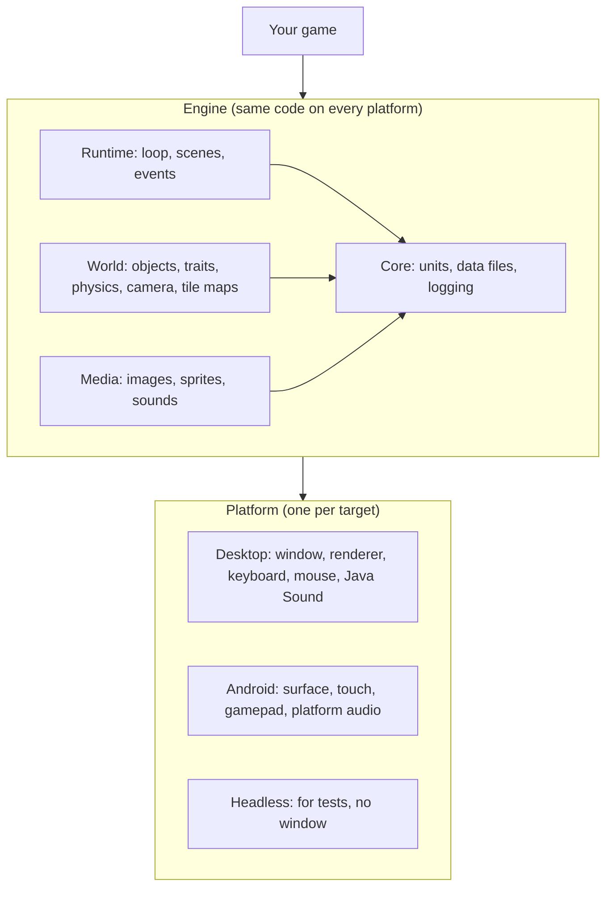
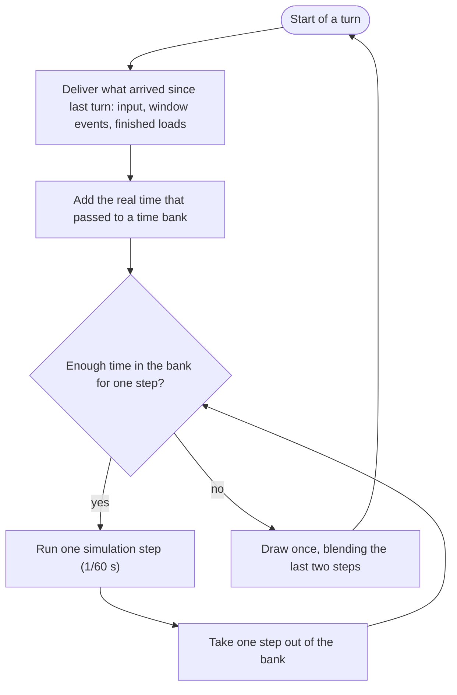
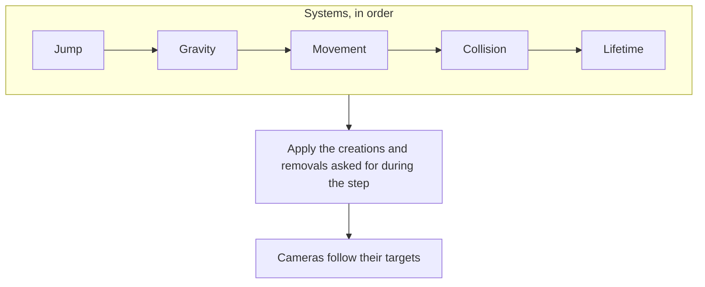
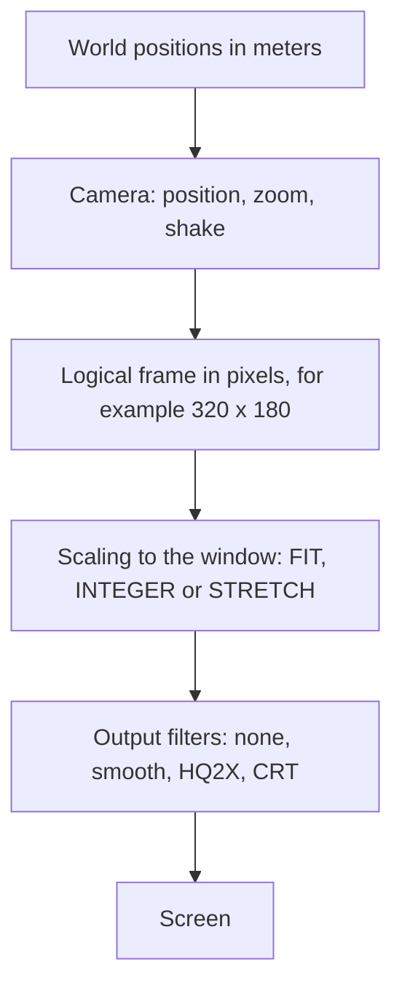
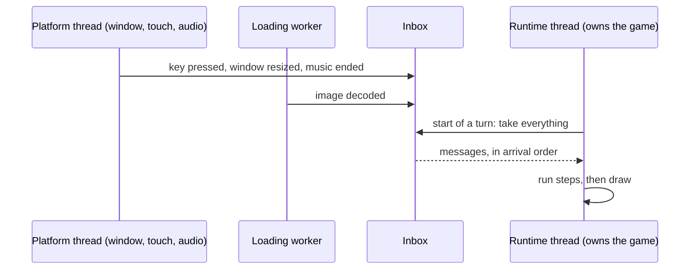
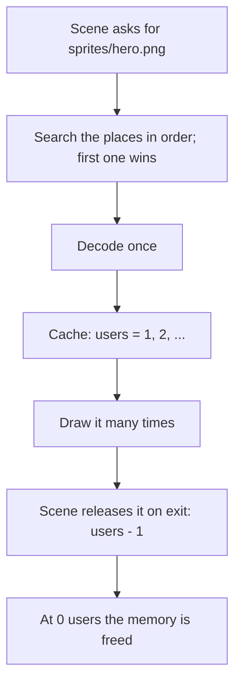
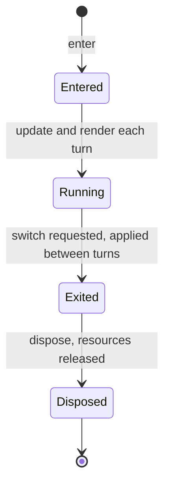
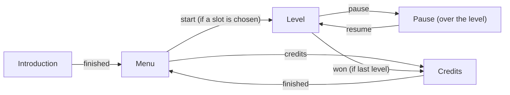
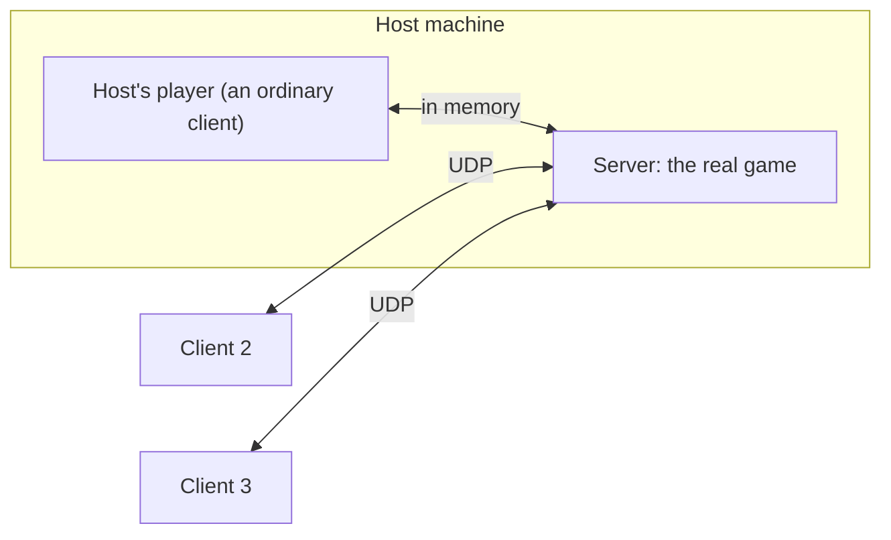
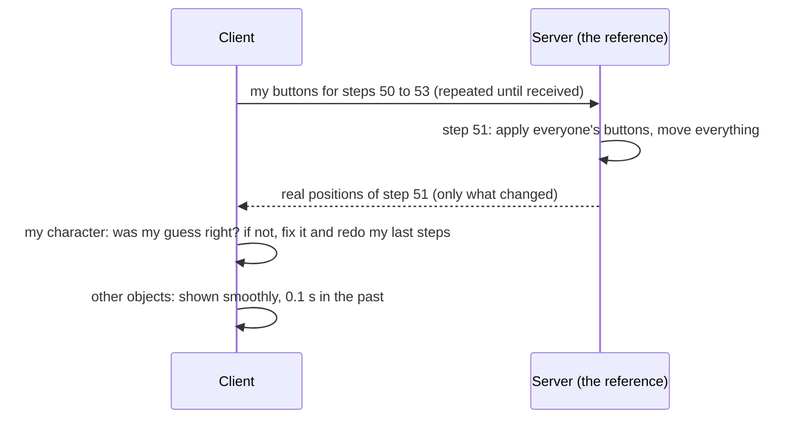

# How the engine works

**Status: VALIDATED — plain-language summary of the architecture. When it seems to disagree with an ADR or `requirements.md`, the ADR and the requirement win.**

LionEngine is a Java library for 2D games. A game uses it to run a loop, show images, play sounds, move objects and read the player's input, on desktop and on Android, with the same game code.

## 1. The big picture

The game talks only to engine contracts. Platform modules plug in underneath and can be swapped.

## 2. One turn of the loop

The simulation always advances in fixed steps (60 per second by default), whatever the speed of the machine. Drawing happens once per turn and blends the last two steps so motion stays smooth.

- A slow machine runs several steps before drawing once (it skips drawings, never steps).
- If the machine falls far behind (more than 0.25 s), the extra time is dropped so the game slows down instead of freezing.
- Pause stops the time bank; slow motion makes it fill more slowly.

## 3. Inside one simulation step

Objects are just IDs. Their data ("traits", such as position or speed) is processed by "systems" in a fixed order.

- Game systems can be inserted anywhere in this order.
- Objects created or removed during a step appear or disappear only at the end of it, so nothing breaks while systems are running.

## 4. From the world to the screen

The world is measured in meters with Y going up. The screen is measured in pixels with Y going down. Only the camera converts between them.

The game draws by writing commands (which image, where, how big, which layer); the platform renderer executes them.

## 5. Threads: who does what

One thread, the runtime thread, owns the whole game state. Other threads never touch it: they drop messages in an inbox.

## 6. Loading and releasing files

Every file has a key such as `sprites/hero.png`. The engine looks for it in an ordered list of places (folder, archive, Android assets), decodes it once and counts who uses it.

Data files (sprite sheets, maps, object definitions) are JSON. A mistake in a data file is reported with the file, the line and the field.

## 7. Scenes

A scene is one part of the game: a menu, a level, a loading screen. Exactly one is active; switching happens between two turns, never in the middle of a step.

A pause menu can be shown over a level: the level stays drawn but stops updating.

The links between scenes are declared once, in a **scene flow**: "when the intro says *finished*, go to the menu", "when the menu says *start* and a save slot is chosen, go to the level". Scenes only say what happened; the flow decides where to go.

## 8. Input

The game reads actions such as "jump" or "move left", not keys. A table binds keys, buttons, sticks or touch to actions, so players can rebind them and the same code works with a keyboard or a gamepad. A quick tap is always seen by exactly one step.

## 9. Playing over the network

One machine is the **server**: it runs the real game. The others are **clients**: they send what their player does and show what the server tells them. The server can also be a player's own machine (the *host*).

- Clients never decide anything that matters (hits, scores): the server does, so the game cannot drift apart between machines.
- Your own character moves at once (the client guesses, then checks against the server); everything else is shown slightly in the past so that it moves smoothly.
- Joining takes an IP address, a port and a player name. Everybody sees the same player list and can chat.

## 10. Units everybody uses

| Quantity | Unit |
|---|---|
| Position, size, distance | meters |
| Time, durations | seconds |
| Speed | meters per second |
| Acceleration, gravity | meters per second² (gravity is negative: down) |
| Angles | degrees, counter-clockwise, 0° pointing right |
| Images, screen, tiles on screen | pixels |
| Tile coordinates in a map | whole numbers, origin at the bottom-left |

## Where to go next

- What a game can do, area by area: [`engine-features.md`](engine-features.md).
- Network play in detail: [`features/network.md`](features/network.md) and [`features/multiplayer.md`](features/multiplayer.md).

- Rules for contributors and agents: [`../AGENTS.md`](../AGENTS.md).
- Every contract in detail: [`architecture/contracts.md`](architecture/contracts.md); modules: [`architecture/modules.md`](architecture/modules.md).
- What must be built: [`requirements.md`](requirements.md); why: [`decisions/`](decisions/README.md).
- Implementing the engine, batch by batch: [`features/`](features/README.md).
- Building a game: [`game-development-guide.md`](game-development-guide.md) and [`api-index.md`](api-index.md).
